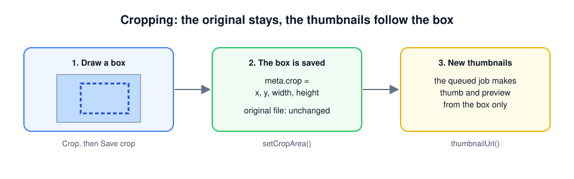

# Cropping images

A photo of a product is often taken from too far away, or the subject is not in the middle. With cropping, an editor draws a box around the part that matters, and the thumbnails are made from that part only.



Three things are good to know before you start:

- **The original file is never changed.** The package only remembers the box: where it starts and how big it is. The thumbnails and previews are made from that box. Because the original stays, you can crop again or undo the crop at any time.
- **It works for images only.** PDFs, videos and other files get no Crop button.
- **One box per upload.** Every conversion (`thumb`, `preview` and the ones you add) is made from the same box.

The crop tool itself is [Cropper.js](https://github.com/fengyuanchen/cropperjs), a small JavaScript library. You do not have to install it: the upload manager loads it for you.

## Step 1. Turn it on

Cropping is off by default. Add `:crop="true"` to the upload manager on your page:

```blade
<livewire:uploads.upload-manager
    :model="$product"
    collection="photos"
    :public="true"
    accept="jpg,jpeg,png,webp"
    :crop="true"
/>
```

Reload the page. Every image in the list now has a **Crop** link next to **Open**.

{: .note }
Write `:crop="true"` with the colon. Without it, Livewire receives the text `"true"`, not the value `true`.

## Step 2. Crop a photo

1. Click **Crop** under a photo. A window opens with the full photo and a box on top of it.
2. Drag the box to move it, and drag its corners to make it bigger or smaller.
3. Click **Save crop**.

The list shows "Processing" for a moment while the new thumbnail is made, and "Cropped" after the file name once it is done.

To go back to the whole photo, click **Crop** again and choose **Use the whole image**. **Cancel** closes the window and changes nothing.

{: .note }
When the thumbnail does not change, the queue worker is probably not running: the new thumbnail is made by the same job as the first one. Run `php artisan queue:work`, or set `UPLOADS_QUEUE_CONNECTION=sync` in `.env` while you develop. See [How it works](how-it-works.md#the-queue).

## Step 3. A fixed shape (optional)

Without more settings the editor can draw any shape. When every photo on your site has the same shape, for example wide banners or square avatars, fix it with `aspect-ratio`:

```blade
<livewire:uploads.upload-manager :model="$product" collection="photos" :crop="true" aspect-ratio="16/9" />
```

| You want | Write |
| --- | --- |
| Any shape | leave `aspect-ratio` out |
| A square | `aspect-ratio="1"` |
| Wide, like a video | `aspect-ratio="16/9"` |
| A classic photo | `aspect-ratio="4/3"` or `aspect-ratio="3/2"` |
| Tall, like a portrait | `aspect-ratio="3/4"` |

`16:9` and `1.5` work too.

The shape only limits the box. A conversion with `fit` set to `cover` still cuts its own shape out of the box, so a square `thumb` of a 16:9 crop shows the middle of it. Give the conversions the same shape as the crop when the whole box has to be visible, see [Conversions & PDF pages](conversions-and-pdf.md).

## In your own code

The upload manager uses two methods on the upload that you can call yourself, for example in a seeder or your own form:

```php
$photo = $product->firstUpload('photos');

// Keep a box of 800 × 450 pixels, 100 from the left and 50 from the top of the original.
$photo->setCropArea(['x' => 100, 'y' => 50, 'width' => 800, 'height' => 450]);

$photo->cropArea();          // ['x' => 100, 'y' => 50, 'width' => 800, 'height' => 450]

// Use the whole image again.
$photo->setCropArea(null);
```

The numbers are pixels of the original image. `setCropArea()` saves the box in the upload's `meta` under `crop` and queues the job that makes the conversions again. It throws an `InvalidArgumentException` for a file that is not an image, or for a box without `x`, `y`, `width` and `height`, a negative position or a size below 1 pixel. A box that reaches past the edge of the image is kept inside the image.

Show the result like any other conversion:

```blade
thumbnailUrl()) ?>" alt="<?= e($photo->meta('caption', $photo->name)) ?>">
```

The address of a conversion on the public disk ends with `?v=` and a number, for example `photo-thumb.webp?v=1793606838`. The number changes every time the conversions are made again, so browsers show the new thumbnail instead of the old one they remembered.

## Where Cropper.js comes from

By default the upload manager loads Cropper.js 1.6.2 from [jsDelivr](https://www.jsdelivr.com/package/npm/cropperjs), a free service that hosts JavaScript libraries. It is loaded once per page, and only on pages with `:crop="true"`.

The addresses are in `config/uploads.php`:

```php
'cropper' => [
    'script' => env('UPLOADS_CROPPER_SCRIPT', 'https://cdn.jsdelivr.net/npm/cropperjs@1.6.2/dist/cropper.min.js'),
    'style' => env('UPLOADS_CROPPER_STYLE', 'https://cdn.jsdelivr.net/npm/cropperjs@1.6.2/dist/cropper.min.css'),
],
```

### Loading it yourself

You may not want the browser of your editors to contact jsDelivr, for example because of your privacy policy. Then install Cropper.js in your own app:

```bash
npm install cropperjs@1
```

Make it available to the page in `resources/js/app.js`:

```js
import Cropper from 'cropperjs'
import 'cropperjs/dist/cropper.css'

window.Cropper = Cropper
```

Build the assets with `npm run build` (or keep `npm run dev` running), and tell the package not to load anything itself:

```
UPLOADS_CROPPER_SCRIPT=
UPLOADS_CROPPER_STYLE=
```

Use version 1 of Cropper.js: version 2 works in a completely different way and does not fit the upload manager.

## Tailwind

The crop window uses Tailwind classes, like the rest of the upload manager. Tailwind only generates the classes it finds in your files, so let it read the views of the package. With Tailwind 4, add this line to `resources/css/app.css`:

```css
@source '../../vendor/darvis/laravel-uploads/resources/views';
```

Without it, the window still works, but it has no size or backdrop.

## When something goes wrong

| What you see | Why | What to do |
| --- | --- | --- |
| No **Crop** link | `:crop="true"` is missing, or the file is not an image | Add `:crop="true"`; PDFs and videos cannot be cropped |
| **Crop** does nothing | Cropper.js is not loaded. The browser console (F12) says "Cropper.js is not loaded." | Check the `cropper` addresses in `config/uploads.php`, or load it yourself as above |
| The window opens without a photo | The browser cannot open the original | Click **Open** under the photo; if that fails too, see [Troubleshooting](troubleshooting.md) |
| The thumbnail stays the same | The job did not run yet | Start `php artisan queue:work` |
| "The crop area is not valid." | The box had no size | Draw a bigger box and save again |
| 403 after **Save crop** | The policy of your model does not allow `update` | See [Livewire components](livewire.md#authorization) |
