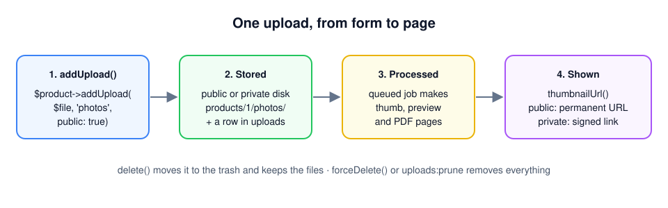

# How it works

This page explains the words the rest of the documentation uses. You do not need it to follow the [tutorial](tutorial.md), but it helps when you want to understand why something works the way it does, or when you build something the tutorial does not cover.

## The life of one upload



When your code calls `$product->addUpload($file, 'photos', public: true)`, this happens:

1. **The file is stored.** It goes to the public or the private *disk* (see below), in the folder `products/<id of the product>/photos/`, under a new random name such as `7131d4ec-….jpg`. The original name is kept, but not as the file name, so two files called `photo.jpg` never overwrite each other.
2. **A row is written.** The `uploads` table gets one row with everything about the file: where it is, its original name, its size and type, who uploaded it, which model and collection it belongs to, and your extra data.
3. **A job is queued.** A *job* is a piece of work that runs after the request. This one, `ProcessUpload`, makes the smaller versions of an image (the *conversions*) and an image of every page of a PDF, and stores them next to the original.
4. **Your page shows it.** You ask the upload for an address, `url()`, `thumbnailUrl()` or `downloadUrl()`, and put that in your HTML.
5. **It is deleted.** `delete()` moves the upload to the trash and keeps the files, so it can be restored. `forceDelete()`, or emptying the trash, removes the row and every file.

The rest of this page explains each of those words.

## The upload

Every file is one row in the `uploads` table, and in PHP one `Darvis\Uploads\Models\Upload` object. That object is what you work with: it knows its own addresses (`url()`, `thumbnailUrl()`), its size (`humanSize()`), its type (`isImage()`, `isPdf()`) and your extra data (`meta('caption')`). Every column is listed in [The Upload model](the-upload-model.md).

## The owner

Most files belong to something: the photos of a product, the attachments of a ticket, the avatar of a user. That something is the *owner* of the upload, and it can be any model in your application. The `uploads` table remembers it in two columns, `uploadable_type` (which kind of model, for example `App\Models\Product`) and `uploadable_id` (which one). Laravel calls this a *polymorphic relation*; you only need to know that one table serves every model.

A model becomes an owner when it uses the `HasUploads` trait. A *trait* is a set of methods you add to a class with one `use` line:

```php
class Product extends Model
{
    use HasUploads;
}
```

## The collection

A collection is a name you choose to keep the files of one owner apart: `photos`, `manuals`, `invoices`. It is just text in the `collection` column; there is nothing to register. When you leave it out, the collection is `files`.

```php
$product->addUpload($file, 'manuals');
$product->uploadsIn('manuals')->get();    // only the manuals
$product->firstUpload('photos');           // the first photo, for example as the cover
```

`uploadsIn()` gives you a *query*, not the files themselves yet: add `->get()` to fetch them, or `->first()` for one. You can narrow it down further before you fetch, for example `->take(3)->get()` for the first three. A `foreach` straight over `uploadsIn('photos')`, without `->get()`, loops over nothing.

## Disks: public and private

Laravel stores files on *disks*. A disk is a place with a name, set up in `config/filesystems.php`: a folder on your server, or a bucket on Amazon S3. Your code only uses the name, so moving to S3 later is a change in the configuration, not in your code.

The package uses two disks:

| | Public | Private |
| --- | --- | --- |
| Default disk | `public` | `local` |
| Folder in a new Laravel app | `storage/app/public` | `storage/app/private` |
| Who can open it | everyone with the address | only through a signed link, after the policy said yes |
| Address | permanent, for example `/storage/products/1/photos/….jpg` | temporary, for example `/uploads/12?expires=…&signature=…` |
| For | product photos, a logo, images on public pages | invoices, contracts, print files, anything personal |

You choose per upload with `public: true` or `public: false`. Without it, an upload is **private**, so a file is never public by accident.

The public folder is only reachable from the browser after `php artisan storage:link`, which creates the link `public/storage` to `storage/app/public`. The private folder is never linked.

## Conversions

A photo from a phone is easily 5 MB and 4000 pixels wide: far too big for a list of thumbnails. So the package makes smaller copies, the *conversions*, once, right after the upload. Two are configured by default:

| Name | Size | Fit |
| --- | --- | --- |
| `thumb` | 300 × 300 | `cover`: cropped to fill the square |
| `preview` | 1200 wide | `contain`: scaled down, nothing cut off |

Both are stored as WebP next to the original, as `<name>-thumb.webp` and `<name>-preview.webp`. Ask for them with `thumbnailUrl()` and `conversionUrl('preview')`. As long as a conversion does not exist yet, those methods return the address of the original, so a page never shows a broken image.

A PDF gets an image of every page, and the conversions are made from its first page, so a PDF has a thumbnail too. Add your own sizes in `config/uploads.php`, see [Conversions & PDF pages](conversions-and-pdf.md).

## The queue

Making conversions of a large photo, or rendering a 40 page PDF, takes seconds. A visitor should not wait for that, so the package does it in a *job* on the *queue*: the request stores the file, puts a note "process upload 12" in the queue and answers right away. A separate process, the *worker* (`php artisan queue:work`), picks up the note and does the work.

Two settings decide where the note goes:

- `UPLOADS_QUEUE_CONNECTION=sync` in `.env`: there is no note, the work is done right away during the request. Easy while you develop or test, slow for big files.
- No setting: the job goes to the queue of your application (`QUEUE_CONNECTION`, in a new Laravel application `database`). A worker has to run, on your computer in a second terminal and on your server all the time.

When thumbnails never appear, the first thing to check is whether a worker runs, see [Troubleshooting](troubleshooting.md#conversions).

## Signed links and the policy

A private file cannot be opened through a plain address, because there is none. `url()` on a private upload returns a *signed link* to the route of the package:

```text
https://example.com/uploads/12?expires=1767225600&signature=5f1c…
```

The signature is a fingerprint of the address, made with your application's secret key (`APP_KEY`). Change the `12` into `13`, or the expiry time, and the fingerprint no longer matches, so Laravel refuses the link. After 30 minutes (`link_expires_after_minutes`) the link stops working.

A valid link is not enough, though. The route also asks the *policy*, `UploadPolicy`, whether the person who clicks may see the file. By default that is the person who uploaded it, the user who owns the model (a `user_id` column on the product, for example) and an administrator (an `is_admin` column on the user). A visitor who is not logged in is always refused. You can replace the policy with your own rules, see [Private files](private-files.md).

## The trash

`$upload->delete()` does not delete anything yet. It fills the `deleted_at` column, which makes the upload disappear from `uploadsIn()` and from your pages, but the files stay. That is a *soft delete*: `$upload->restore()` brings it back.

`$upload->forceDelete()` removes the row and every file, conversions and pages included. The command `php artisan uploads:prune` does that for everything that has been in the trash longer than 30 days (`prune_after_days`); schedule it once a day, see [Administration & trash](administration.md).

## Where to go next

- [Tutorial: your first upload](tutorial.md) if you have not built the photo page yet.
- [The Upload model](the-upload-model.md) for every column and method.
- [Installation & configuration](installation.md) for every setting in `config/uploads.php`.
